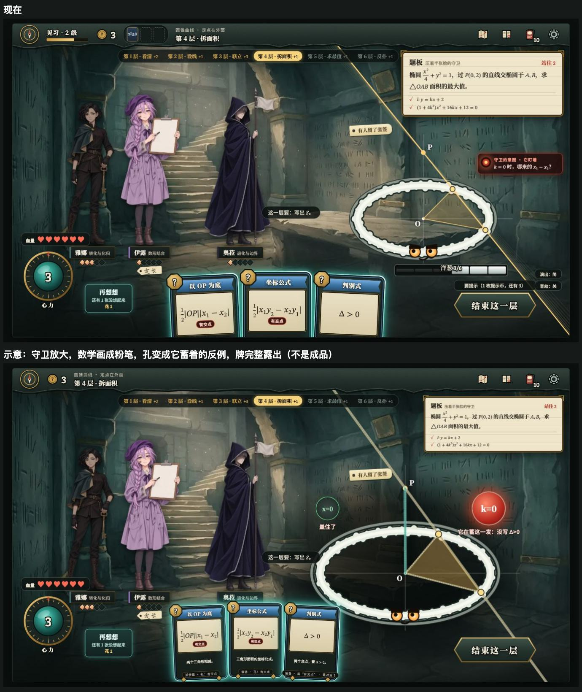
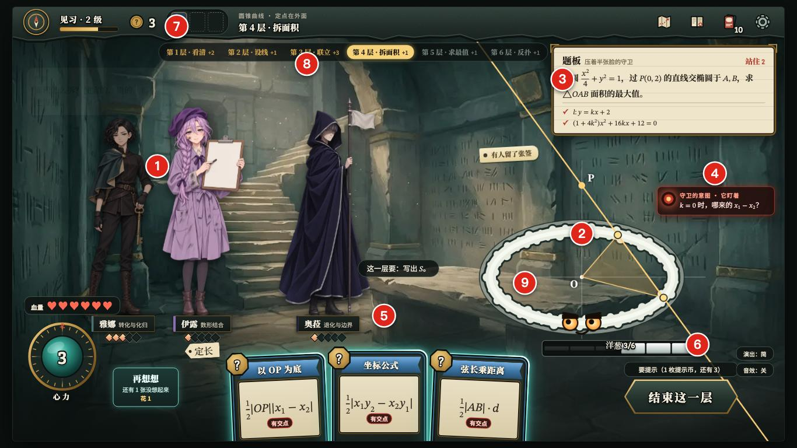

# 《罗盘指挥官》卡牌版：美术与设计优化意见稿

Claude 2026-11-12。看的是交接基线（`SNAPSHOT-20261109`），1366×768，真机截图和页面内实测。**只提意见，没改任何游戏文件**，交接清单的哈希不受影响。图在同名的 `-图/` 文件夹。

## 一、结论

**现在的版本，规则和反馈是成立的，短板在三处：**

1. **主角太小。** 守卫和它身上的几何，是这个游戏唯一“只有我们有”的东西，却只占画面 5%；三个站着不动的队友占 26%。
2. **画面上有五种互不相干的画法。** 厚涂背景、动漫立绘、黄铜羊皮纸界面、扁平矢量的守卫和线、公式。数学那一层最像“贴上去的”。
3. **最要紧的动作还是填表。** 而且填表这件事本身有三个会让学生冤死的毛病（见第四节 D1）。

**如果只做三件事**，我选：守卫放大并把数学画成粉笔（A1、A2）；把“孔”从牌上的小红字变成守卫蓄着的反例（D2）；修输入（D1）。前两件的效果见下图，是运行时临时改出来的示意，不是成品。

## 二、量出来的

| 项 | 实测 | 说明 |
|---|---|---|
| 守卫占画面 | 380×190，约 5% | 三个队友的立绘合计约 26% |
| 小字 | 61 处文字里 28 处小于 14 号 | 1366 屏上实际不到 12 像素；教室投影更看不清。最小 11 号（牌的类型行） |
| 手牌露出 | 69% | 牌高 266，从 716 排到 982，舞台只到 900。下半截要悬停才看得到 |
| 触屏 | 牌的悬停只有鼠标事件 | 一体机和手机上，看不到牌的下半截就得出牌 |
| 一场要填的空 | 第一只 13 个，第二只 12 个 | 最省路线 |
| 第一只的战前剧情 | 41 步，约 600 字 | 一个选项，一段拖动 |
| 结算页 | 274 字，5 个按钮，7 块内容 | 紧跟在爆炸后面 |
| 同一件事的重复显示 | 剥到第几层：3 处 | 顶上的层条、守卫外圈、“洋葱 3/6”进度条 |
| 外部依赖 | KaTeX 走 cdnjs，字体走 Google Fonts | 断网或被墙时，公式变成源码，字体回退 |
| 没用上的素材 | 表情立绘 76 张 | 战前剧情只用了每人一张站姿，全程一个表情 |
| 对比度 | 都在 4.5 以上 | 这项没问题，问题是字小 |

图上的号：①队友占地最大、动得最少；②数学舞台太小，线还从题板底下穿过去；③题板压住了 P 点上方；④意图是一段红框里的字；⑤手牌被切掉三成；⑥右下一堆小按钮和重复的洋葱条；⑦顶栏的“见习 2 级”和装备槽在卡牌版里没有任何作用；⑧层条；⑨守卫是个空心圈，没有材质。

## 三、美术

### 总方向：四种材质，各管各的

画面上每样东西只能属于下面四种之一。不属于的，要么改，要么删。

| 材质 | 管什么 | 现在谁不合群 |
|---|---|---|
| **雾** | 守卫。序章就写了“雾做的守卫” | 守卫现在是干净的矢量圈 |
| **粉笔** | 一切数学：线、交点、三角形、扇形、盖屏的结论 | 现在是细黄线，压在石墙上看不清 |
| **纸** | 学生和队友的东西：牌、题板、纸签、对话框 | 基本合群 |
| **黄铜** | 系统：心力、血量、顶栏 | 提示、音效、演出三个胶囊按钮；意图红框 |

颜色也只留三个意思：**金＝站住的结论，红＝守卫和反例，青＝你能动的东西**（心力、可出的牌、你的签）。现在金色同时用在层条、费用、线、盖章、牌的描边上，意思是散的。

### A1 守卫放大，给它一块“黑板”　〔效果大，工作量小〕

- 几何单位从 95 提到 120 左右，守卫宽约 490。队友不用缩，题板缩到 86%。
- 守卫身后压一块暗色椭圆，线和三角形才有底可衬。示意图里就是这么做的。
- 打开算题面板时，镜头再往守卫推一点，队友让出画面。

### A2 数学一律画成粉笔　〔效果大，工作量小〕

- 线、三角形的边、扇形的边，都用粗一点、有颗粒的粉笔笔触；填充用半透明的金。
- 盖屏的结论也用粉笔字的质感，和题板上的“✓”一个手感。
- 被用作“底”的那条定长边单独一个颜色（示意图里的青色 OP）。学生一眼看见“哪条边不动”，这正是拆面积那一步的关键。

### A3 守卫要有材质和个性　〔效果大，工作量中〕

- 身体改成雾：边缘有流动的噪声，内侧有一圈淡淡的光，受击时雾被打散再聚拢。
- 每只守卫的外形要讲它的坑。第二只“肚子里有颗钉子”，就该在钉子那儿鼓出一块，拖线经过时肚子跟着动。现在两只只差颜色和一个红点。
- 这条建议写进 B1：“根据地”那只是后面所有守卫的样板，别再出一个换色的圈。

### A4 牌面：先图后式　〔效果大，工作量中〕

- 牌面中间现在是一条公式。改成**小图在上、公式在下**：“以 OP 为底”画一个底边高亮的三角形，“弦长乘距离”画弦和垂线，“判别式”画相切、相交、相离三个小图。图由代码按这一关的真值画，不用出图。
- 好处有两个：选牌变成看图判断；牌终于有了能认的脸。
- 手牌整体缩到 0.8、上移，让整张牌露出来（示意图里已这么摆）。

### A5 战前剧情用上表情立绘　〔效果中，工作量小〕

- 库里有 76 张表情立绘，剧情只用了站姿。`前情.json` 每句加一个表情字段就行，老的剧情播放器本来就是这么做的。
- 塔莉抠到泥、雅娜说“那只手”，这种梗没有表情撑不起来。
- 三个人现在挤在左边互相遮挡。说话的人居前放大，其余两人退后变暗。

### A6 切入和收招按脸取景　〔效果中，工作量小〕

- 收招的三条竖切现在按固定位置裁全身图，有人只露到胸口，奥菈只露出兜帽顶。每个角色记一个“脸的位置”，按它取景。
- 色带用纸和墨的质感，别用纯色渐变。你买的白色几何素材可以先在这儿试。

### A7 营地地图别用“守、拓、园”三个字　〔效果中，工作量中〕

- 节点画成这只守卫的剪影：椭圆、椭圆里一颗钉子、线段。学生看图就知道下一只是什么曲线。
- 路线画成手账上的手绘线，和早先定的“雾野手账”一致。
- “开发用”三个按钮现在学生看得见，收进一个快捷键。

### A8 清掉没用的界面　〔效果小，工作量小〕

- 顶栏的“见习 2 级”、经验条、装备槽 `x²≥0`：卡牌版里是死的，去掉。
- “洋葱 3/6”进度条：和层条、守卫外圈重复，去掉。
- 提示、音效、演出：收进顶栏的齿轮。
- 字号下限定 15 号。牌的类型行、层条上的“+1”、各处的小字都要提。

## 四、设计

### D1 输入会让学生冤死　〔必须修〕

实测现在的解析：

- `1/2k` 被读成 $\frac{k}{2}$，学生多半想写 $\frac1{2k}$。
- `2t/t^2+1` 被读成 $\frac{2}{t}+1$，学生想写 $\frac{2t}{t^2+1}$。

读错了就判错，扣一滴血。学生会觉得是游戏坑他，而且他学到的是“这游戏不讲理”。牌长大以后要整条式子自己写，这个问题只会更多。

- **输入框下面实时显示“机器是这么理解的”**，用排好的分式显示。现在的预览只是把字符原样塞回去，看不出分子分母。
- **加一排软键盘**：$k$、$m$、$t$、平方、根号、分数线、括号、绝对值。按“分数线”直接出上下两个框，从根上消掉歧义。手机和一体机没有它基本没法输入。
- 读不懂、有歧义时只提示，不扣血。只有数学错才挨打。

### D2 “孔”要从牌上搬到守卫身上　〔效果最大的一条〕

孔是这个游戏最有教学价值的设计，现在的表现是牌面下方一个 12 号的红色小标签，还常被切在屏幕外面。

- **没盖的孔，就是守卫头顶蓄着的一颗反例球**，上面写着 `k=0`、`x=0`、`等号`。旁边一行小字说它蓄的是什么。
- 盖住孔，球当场瘪掉变灰，留在原地当战利品。
- 硬出刀，就是这颗球飞过来打你。现在本来就有球飞过来，只是出牌前看不见它。
- 这样“意图”那个红框可以整个去掉：守卫想干什么，学生抬头就看见。

示意图右上的红球和左边瘪掉的 `x=0` 就是这个意思。

### D3 藏价要配一个“估”　〔效果大，工作量小〕

现在没走过的路标“?”，学生只能盲付，透支了才知道。这是罚，不是决策。

- 第一次出一张没标价的牌，先点一下：**省事、一般、费事**。一下就够。
- 然后亮出真价。估对了，这张牌的“?”换成一个小印记，下回别的关里也算见过。
- 这正是你五格流程里的“估”，现在游戏里缺的就是这一格。

### D4 输了别从头再填一遍　〔效果大，工作量小〕

现在输了回第一层，已经算对的系数要原样再打一遍。好学生会烦。

- 输了可以“从这一层再来”，站住的结论都留着，血量给 3，这一场最多两星。
- 想拿三星的，自己选“从头来”。
- 中途退出也按层存一下，回来接着打。现在一退出整场作废。

### D5 结算页分三拍　〔效果中，工作量小〕

爆炸之后紧跟 274 个字和 5 个按钮，高潮被文字冲掉了。

1. 第一拍：星星，加一句话。有漏洞就是那块墓志铭，没漏洞就是你开打前猜的那句。
2. 第二拍：你走的路，画成一串费用小圆片，贵的那几步标红。不用读字就看得出哪儿绕了。
3. 第三拍：只留一个主按钮“留一张签”。落笔、再打、关灯、回营地收成一排小的。

### D6 规矩别写在选队页　〔效果中，工作量小〕

选队页左边现在有四段“规矩”。没人读。

- 删掉。每条规矩在它第一次起作用的那一下，由队友说一句：第一次透支，雅娜说“心力不够，拿血垫的”；第一次硬出刀挨打，奥菈说“孔没盖”。
- 第一只守卫的第一层本来就只有“细看”，已经是在教了，顺着做下去就行。

### D7 关灯做成“把灯点回来”　〔效果中，工作量小〕

关灯现在是黑屋子里的一张六步表格，是全游戏最不像游戏的一段，偏偏它最有检验价值。

- 屋里六盏灯全灭，只剩守卫两只红眼。每写对一步，亮一盏，屋子亮一分。
- 六盏全亮，守卫现形，然后才是收招。进度条就是这六盏灯。
- 输了，碑上写“此人点到第三盏”。

### D8 老师端：从“学生说哪儿难”到“学生死在哪儿”　〔效果大，要你定〕

交给老师的码里现在只有纸签。游戏其实记着每个人**死在哪一层、撞了哪个孔、关灯过没过**。

- 把这几项不带文字的数字一起放进码里，审核页就能画出“全班真正卡在哪儿”，和“全班自己觉得卡在哪儿”并排看。两张图的差，就是最值得讲的那节课。
- 这也是你见校长时最拿得出手的一页。
- 里面没有姓名和文字，只有笔名对应的数字。但它是学生的行为数据，**放不放由你定**，我不替你做主。

### D9 抽牌先别动，先量　〔观察项〕

“再想想”花 1 点，经济又卡得紧，手气差的学生会被运气罚。但现在没数据，不该先改。

- 记录每场点了几次“再想想”。真人试玩后，平均超过每场 1.5 次，就把每层手牌从 3 调到 4。

### D10 断网也要能打开　〔必须修，要你或 Astra 动手〕

公式库和字体都从外网拉。教室断网、家里网不好时，题目显示成一串带反斜杠的源码，等于没法玩。

- 把 KaTeX 和要用的字体放进项目本地。我这边不能下载外部代码，这件事要你或 Astra 做。
- 这条和好不好看无关，但它决定了第一次拿给学生时会不会当场出丑，所以排在前面。

## 五、先后

| 顺序 | 做什么 | 理由 |
|---|---|---|
| 开工前就该做 | D1 输入、D10 断网 | 不修，真人试玩的结果不可信 |
| 并进 B1 | A1、A2、A3、D2 | “根据地”是样板，这四条定了，后面每只守卫都继承 |
| B1 之后一起做 | D3、D4、D5、D6、A5、A8 | 都小，都不依赖新内容 |
| 铺内容时顺手 | A4、A6、A7、D7 | 每多一只守卫多一份工，适合等格式稳了再做 |
| 等你定 | D8 | 涉及学生数据 |
| 等数据 | D9 | 没真人数据前不动 |

## 六、不建议做的

- **不要加新系统。** 这一版缺的是把已有的东西摆对位置。意见稿里没有一条是新规则。
- **不要先做配乐和大量音效。** 画面的主次没理顺之前，声音加得越多越乱。
- **不要给队友加待机动画和骨骼。** 他们已经占了太多注意力，再动起来更抢戏。钱和工夫花在守卫上。
- **不要把示意图当成品。** 粉笔笔触、反例球的造型都只是指个方向。

## 七、我没法替你判断的

- 这些都是我看截图、量数字、读代码得出的。**没有一条被学生验证过。**
- 粉笔和雾的方向对不对，是审美判断，你看示意图的第一反应比我的理由重要。
- 手机怎么办没有答案。舞台是 1600×900 的横屏，手机竖着拿基本看不清。之前定的是先只做电脑端，这份意见稿也按电脑端写。
